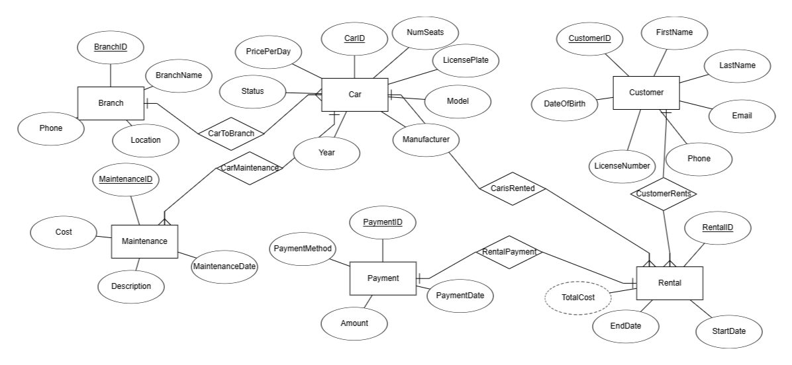
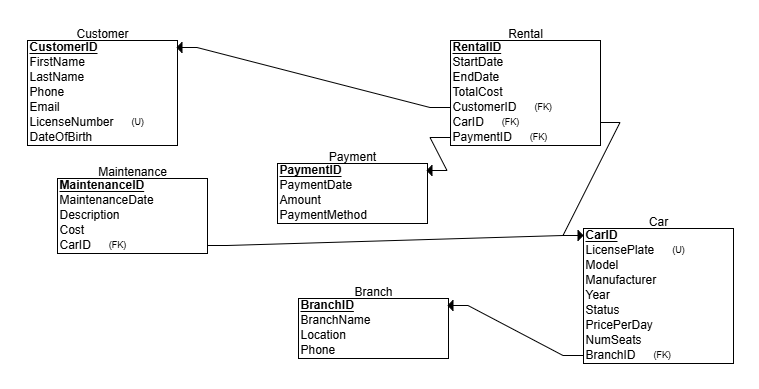
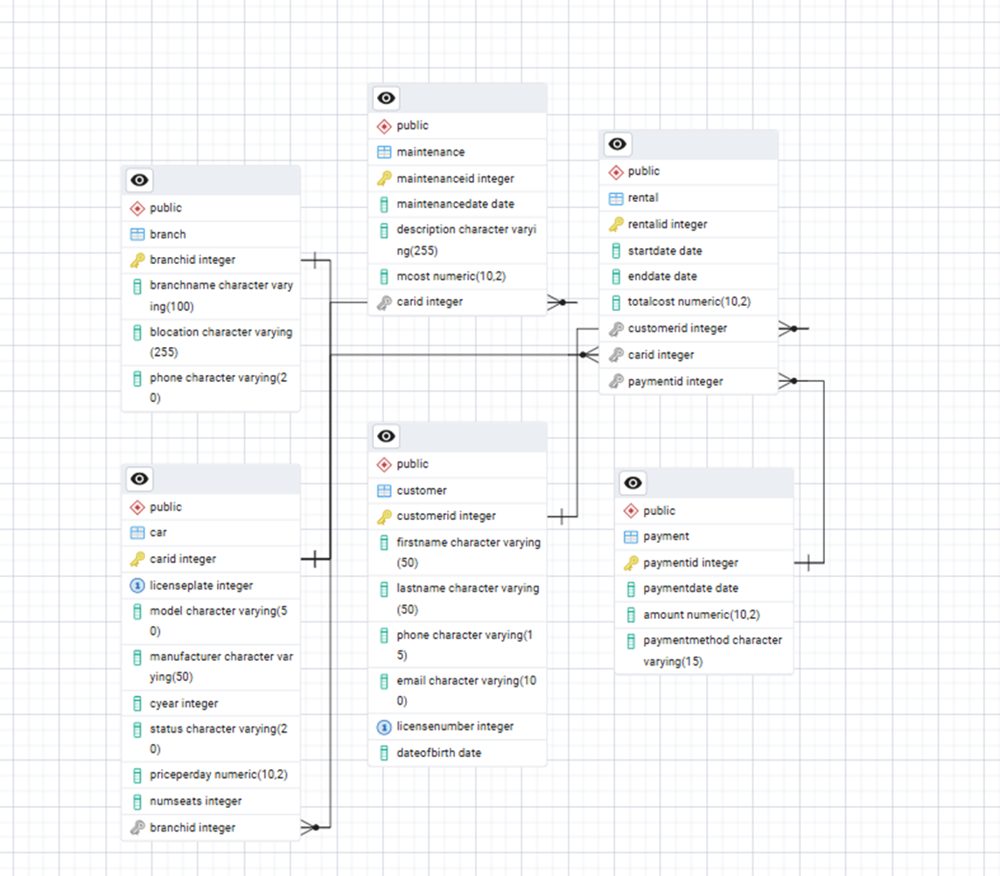

# DBProject_4254_2894

# Trips

# Rental car 

## Shira Shenfel 326444254
## Itti Chaimson 326282894

## Table of Contents  
- [Phase 1: Design and Build the Database](#phase-1-design-and-build-the-database)  
  - [Introduction](#introduction)  
  - [ERD (Entity-Relationship Diagram)](#erd-entity-relationship-diagram)  
  - [DSD (Data Structure Diagram)](#dsd-data-structure-diagram)  
  - [ERD Pgadmin](#erd-pgadmin)
  - [Design Decisions](#design-decisions)
  - [SQL Scripts](#sql-scripts)  
  - [Data](#data)
    - [First tool](#first-tool-using-csv-file)
       - [Branch Table Data Entry](#branch-table-data-entry)
       - [Payments Table Data Entry](#payments-table-data-entry)
    - [Second tool](#second-tool-using-generatedata-to-create-csv-file)
       - [Payments Table Data Entry](#payments-table-data-entry-1)
    - [Third tool](#third-tool-using-mockaro-to-create-csv-file)
       - [Car Table Data Entry](#car-table-data-entry)
    - [Fourth tool](#fourth-tool-using-python-to-generate-a-csv-file-and-insert-it-into-the-database)
       - [Customers Table Data Entry](#customers-table-data-entry)
       - [Rental Table Data Entry](#rental-table-data-entry)
       - [Maintenance Table Data Entry](#maintenance-table-data-entry)
  - [Backup](#backup)
  - [Data Restoration](#data-restoration)  
- [Phase 2: Queries and Constraints](#phase-2-queries-and-constraints) 
  - [Queries](#queries)
    - [SELECT](#select)
    - [DELETE](#delete)
    - [UPDATE](#update)
  - [Constraints](#constraints)
  - [Rollback and Commit](#rollback-and-commit)
    - [Rollback](#rollback)
    - [Commit](#commit)
  - [Backup2](#backup2)  
- [Phase 3: Integration and Views](#phase-3-integration-and-views)
  - [DSD of the new organization](#dsd-of-the-new-organization)
  - [ERD of the new organization](#erd-of-the-new-organization)
  - [Unified ERD after integration](#unified-erd-after-integration)
  - [Unified DSD after integration](#unified-dsd-after-integration)
  - [Decisions made during the integration phase](#decisions-made-during-the-integration-phase)
  - [Verbal explanation of the process and commands](#verbal-explanation-of-the-process-and-commands)
  - [The Views and the Queries](#the-views-and-the-queries)
  - [Backup3](#backup3) 
- [Phase 4: PL/pgSQL programming](#phase-4-plpgsql-programming)
  - [Functions](#functions)
  - [Procedures](#procedures)
  - [Triggers](#triggers)
  - [Main Programs](#main-programs)
  - [All Changes](#sql-of-all-the-changes)
  - [Backup4](#backup4)

## Phase 1: Design and Build the Database  

### Introduction

The **car rental system** is one of the core components of the **“Trips”** project.
Its goal is to enable smart, organized, and automated management of processes such as rentals, maintenance, payments, and branches for customers.

The system is designed for organizations that provide car rental services to customers on an ongoing basis.
It allows the storage, analysis, and management of all the information required for the efficient operation of a rental system.
The data is stored in a relational database that maintains logical relationships between entities, based on normalization rules and clear separation of responsibilities across tables.

#### 🧩 Main Data Structure in the System:
🔹 **Customers (Customer)** – Stores personal information of customers: first and last name, phone number, email address, driver’s license number, and date of birth.
Each customer is uniquely identified by CustomerID, and the system tracks all rentals made by the customer.

🔹 **Cars (Car)** – The system manages full data on the vehicle fleet: manufacturer, model, year of production, daily rental price, number of seats, status (Available / Rented / In Maintenance), and a unique license plate.
Each car is assigned to a branch and its status can change over time.

🔹 **Branches (Branch)** – Management of the company's active branches, including branch name, full address, and contact details.
Cars are physically assigned to these branches and serve as pick-up and return locations for rentals.

🔹 **Rentals (Rental)** – The system's core activity. Each rental includes a start and end date, calculated total cost, and is linked to a specific customer, car, and payment.
Each car and customer can only be active in one rental at a time (according to system constraints).

🔹 **Payments (Payment)** – Every rental requires a payment. The system records the amount, payment method (credit card, cash, PayPal), and date of payment.
The data is linked to the corresponding rental record.

🔹 **Maintenance (Maintenance)** – The system documents maintenance actions, recurring issues, and preventive treatments.
It records the description, cost, date, and the car associated with the maintenance.
This enables historical tracking and future maintenance planning.  

#### ⚙️ Core Functionality:
--Create car rentals for customers over a defined date range

--Automatically calculate the total cost based on rental days and car’s daily price

--Monitor car status (Available / Rented / In Maintenance)

--Manage payments for each rental with support for various payment methods

--Maintain vehicle maintenance history and reassign cars to branches as needed

--Maintain logical links between entities: each car belongs to a branch, and each rental links to a customer, car, and payment

--Import data from external sources (CSV / external tools / scripts) and generate reports 

#### 🎯 System Objectives:
• Reduce manual errors

• Improve processing time for rentals

• Monitor and manage vehicle inventory

• Enable flexibility in adding branches, cars, and customers

###  ERD (Entity-Relationship Diagram)    

###  DSD (Data Structure Diagram)   
  

### ERD Pgadmin

### Design Decisions
#### 🧱 Entities & Attributes
**• Customer**
Represents registered customers in the system.

`CustomerID` – Unique identifier

`FirstName` – First name

`LastName` – Last name

`Phone` – Contact number

`Email` – Email address

`LicenseNumber` – Unique driving license number

`DateOfBirth` – Date of birth (type: `DATE`)

**• Car**
Represents cars available for rental.

`CarID` – Unique identifier

`LicensePlate` – Unique license plate

`Model` – Car model

`Manufacturer` – Manufacturer

`Year` – Year of manufacture

`Status` – Status (Available / Rented / In Maintenance)

`PricePerDay` – Rental cost per day

`BranchID` – Foreign key referring to the Branch

`NumSeats` – Number of seats in the car

**• Rental**
Describes rental transactions.

`RentalID` – Unique identifier

`CustomerID`– Foreign key to Customer

`CarID` – Foreign key to Car

`StartDate` – Rental start date (`DATE`)

`EndDate` – Rental end date (`DATE`)

`TotalCost` – Calculated field based on duration and price

`PaymentID` – Foreign key to Payment

**• Payment**
`Tracks payments for rentals.

`PaymentID` – Unique identifier

`RentalID` – Foreign key to Rental

`PaymentDate` – Payment date (`DATE`)

`Amount` – Payment amount

`PaymentMethod` – e.g., Credit Card, Cash, PayPal

**• Branch**
Represents company branches where cars are located.

`BranchID` – Unique identifier

`BranchName` – Name of the branch

`Location` – Branch address

`Phone` – Contact number

**• Maintenance**
Records car maintenance history.

`MaintenanceID` – Unique identifier

`CarID` – Foreign key to Car

`MaintenanceDate` – Date of maintenance (`DATE`)

`Description` – Fault or service description

`Cost` – Maintenance cost

#### 🔗 Relationships
**Customer Rents** – One-to-many (`1:M`) between Customer and Rental
→ A customer can have multiple rentals, but each rental belongs to one customer.

**Car is Rented** – One-to-many (`1:M`) between Car and Rental
→ A car can be rented multiple times, but each rental refers to one car.

**Rental Includes Payment** – One-to-one (`1:1`) between Rental and Payment
→ Each rental has exactly one payment record, and each payment is linked to one rental.

**Car is Managed By Branch**– One-to-many (`1:M`) between Branch and Car
→ A branch manages multiple cars, but each car belongs to one branch only.

**Car Undergoes Maintenance** – One-to-many (`1:M`) between Car and Maintenance
→ A car can undergo multiple maintenance records, but each maintenance belongs to one car.

#### 🧠 Design Considerations
Use of **foreign keys (`FK`)** to ensure data consistency

**Normalization** – Each entity stands alone, with no data redundancy

Use of **`unique` constraints** for fields like `LicensePlate` and `LicenseNumber`

Enorced **1:1 relationship** between `Rental` and `Payment` to ensure that every rental has a single associated payment

Structured according to **Third Normal Form (3NF)** for optimal performance and no duplication

###  SQL Scripts  
Provide the following SQL scripts:  
- **Create Tables Script** - The SQL script for creating the database tables is available in the repository:  

📜 **[View `create1.sql`](שלב%20א/creata1.sql)**  

- **Insert Data Script** - The SQL script for insert data to the database tables is available in the repository:  

📜 **[View `insertTables.sql`](שלב%20א/insertTables.sql)**  
 
- **Drop Tables Script** - The SQL script for droping all tables is available in the repository:  

📜 **[View `dropTables.sql`](שלב%20א/dropTables.sql)**  

- **Select All Data Script**  - The SQL script for selectAll tables is available in the repository:  

📜 **[View `selectAll.sql`](שלב%20א/selectAll.sql)**  
  
###  Data  
####  First tool: using csv file
##### Branch Table Data Entry:
• Branch ID: 4–403
📜**[View `branches1.csv`](שלב%20א/DataImportFiles/branches1.csv)**

results for  the command `SELECT 'Branch' AS TableName, COUNT(*) FROM Branch;`:
 

##### Payments Table Data Entry:
• Payment ID: 4–23
📜**[View `payments2.csv`](שלב%20א/DataImportFiles/payments2.csv)**

#### Second tool: using [generatedata](https://generatedata.com/generator). to create csv file
##### Payments Table Data Entry:
• Payment ID: 24-396
📜**[View `PaymentsInsert1.csv`](שלב%20א/generatedataFiles/PaymentsInsert1.csv)**

results for  the command `SELECT 'Payment' AS TableName, COUNT(*) FROM Payment;`:

####  Third tool: using [mockaro](https://www.mockaroo.com/) to create csv file
##### Car Table Data Entry:
• Car ID: 4–403
-  Formula of Car ID: `this + 4`
📜 **[View `mock_car.csv`](שלב%20א/mockarooFiles/mock_car.csv)**

results for  the command `SELECT 'Car' AS TableName, COUNT(*) FROM Car;`:

####  Fourth Tool: Using Python to generate a CSV file and insert it into the database
##### Customers Table Data Entry:
• Customer ID: 4–403
📜 **[View `customers.csv`](שלב%20א/Programing1/customers.csv)**

**[View `CustomersInsert.py`](שלב%20א/Programing1/CustomerInsert.py)**

results for  the command `SELECT 'Customer' AS TableName, COUNT(*) FROM Customer;`:

##### Rental Table Data Entry:
• Rental ID: 4–403
📜 **[View `rentals.csv`](שלב%20א/Programing1/rentals.csv)**

**[View `RentalInsert.py`](שלב%20א/Programing1/RentalInsert.py)**

results for  the command `SELECT 'Rental' AS TableName, COUNT(*) FROM Rental;`:

##### Maintenance Table Data Entry:
• Maintenance ID: 4–403
📜 **[View `maintenance.csv`](שלב%20א/Programing1/maintenance.csv)**

**[View `MaintenanceInsert.py`](שלב%20א/Programing1/MaintenancesInsert.py)**

results for  the command `SELECT 'Maintenance' AS TableName, COUNT(*) FROM Maintenance;`:

### Backup 
-   backups files are kept with the date and hour of the backup:  

[Navigate to the backups folder](שלב%20א/BackupFiles/Backup2.backup)

[Also backups folder](שלב%20א/BackupFiles/Backup.sql)

### Data Restoration

## Phase 2: Queries and Constraints

### Queries

#### SELECT
##### 1. רשימת רכבים שהושכרו בין תאריכים מסוימים כולל פרטי לקוח ורכב

SELECT c.FirstName, c.LastName, car.Model, car.Manufacturer, r.StartDate, r.EndDate
FROM Rental r
JOIN Customer c ON r.CustomerID = c.CustomerID
JOIN Car car ON r.CarID = car.CarID
WHERE r.StartDate >= '2025-01-01' AND r.EndDate <= '2025-12-31';

שאילתה זו מציגה את פרטי ההשכרות שבוצעו בשנת 2025 בלבד. היא מצטרפת בין טבלאות הלקוח (`Customer`) והרכב (`Car`) דרך טבלת ההשכרות (`Rental`) כדי להחזיר את שם הלקוח, דגם הרכב, היצרן, ותאריכי ההשכרה. מטרת השאילתה היא להבין איזה לקוחות שכרו רכבים באותה שנה ואילו רכבים היו פופולריים.

##### 2. חודשים שבהם מספר ההשכרות היה מעל הממוצע החודשי
SELECT EXTRACT(YEAR FROM StartDate) AS Year,
       EXTRACT(MONTH FROM StartDate) AS Month,
       COUNT(*) AS TotalRentals
FROM Rental
GROUP BY Year, Month
HAVING COUNT(*) > (
    SELECT AVG(MonthlyCount) FROM (
        SELECT COUNT(*) AS MonthlyCount
        FROM Rental
        GROUP BY EXTRACT(YEAR FROM StartDate), EXTRACT(MONTH FROM StartDate)
    ) AS MonthlyData
)
ORDER BY Year, Month;

השאילתה מחשבת את מספר ההשכרות עבור כל חודש (שנה + חודש), ואז באמצעות תת־שאילתה פנימית מחשבת את הממוצע החודשי לכלל התקופה. היא מחזירה רק את החודשים שהיו פעילים יותר מהממוצע. זוהי שאילתה עסקית שימושית לניתוח עומסים עונתיים.

##### 3 ממוצע מספר מושבים לרכבים שהושכרו
SELECT AVG(car.NumSeats) AS AvgSeats
FROM Rental r
JOIN Car car ON r.CarID = car.CarID;

מטרת השאילתה לחשב את מספר המושבים הממוצע של רכבים שבאמת הושכרו. היא עושה שימוש ב־JOIN בין Rental ו־Car, כך שהממוצע מחושב רק על רכבים פעילים במערכת. תוצאה זו יכולה לשמש ככלי תכנוני לרכישת רכבים עם קיבולת מתאימה לביקוש.

##### 4. רכבים שלא עברו תחזוקה כלל
SELECT car.CarID, car.Model
FROM Car car
LEFT JOIN Maintenance m ON car.CarID = m.CarID
WHERE m.MaintenanceID IS NULL;

שאילתה זו עושה שימוש ב־LEFT JOIN כדי להחזיר את כל הרכבים שבמערכת, ומסננת מתוכם את אלו שאין להם התאמה בטבלת Maintenance. זוהי דרך לאתר רכבים שלא עברו שום טיפול תחזוקתי – מידע חשוב למניעת תקלות.

##### 5. תשלום אחרון שבוצע לכל לקוח (לפי תאריך)
SELECT DISTINCT ON (r.CustomerID) r.CustomerID, c.FirstName, c.LastName, p.PaymentDate, p.Amount
FROM Rental r
JOIN Customer c ON r.CustomerID = c.CustomerID
JOIN Payment p ON r.PaymentID = p.PaymentID
ORDER BY r.CustomerID, p.PaymentDate DESC;

באמצעות DISTINCT ON – השאילתה שולפת את שורת התשלום האחרונה (לפי תאריך) של כל לקוח. היא מחזירה את שם הלקוח, הסכום ותאריך התשלום האחרון. זו שאילתה חיונית לצורכי שירות לקוחות ובדיקות פיננסיות.

##### 6. תאריכי התחלה של השכרות בחודש מרץ בלבד
SELECT RentalID, StartDate
FROM Rental
WHERE EXTRACT(MONTH FROM StartDate) = 3;

שאילתה פשוטה יותר המבודדת את ההשכרות שבוצעו בחודש מרץ, על ידי פילוח לפי חודש מתוך שדה התאריך. שימושי לבחינת עונתיות של ההשכרות בתחילת האביב.

##### 7. רכבים עם ההכנסה הכוללת שלהם – רק כאלה שהרוויחו מעל הממוצע
SELECT car.CarID, car.Model, SUM(r.TotalCost) AS TotalIncome
FROM Car car
JOIN Rental r ON car.CarID = r.CarID
GROUP BY car.CarID, car.Model
HAVING SUM(r.TotalCost) > (
    SELECT AVG(TotalCost) FROM Rental
)
ORDER BY TotalIncome DESC;

השאילתה מצטרפת את טבלאות Car ו־Rental, מסכמת את ההכנסה לכל רכב, ומשווה אותה לממוצע הכללי של כלל הרכבים. היא מחזירה רק את הרכבים הרווחיים ביותר, דבר המסייע לקבלת החלטות עסקיות.

##### 8. ממוצע התשלום לפי אמצעי תשלום – רק אם קיימים תשלומים מעל 500 באותו אמצעי
SELECT PaymentMethod, ROUND(AVG(Amount), 2) AS AvgAmount
FROM Payment
WHERE PaymentMethod IN (
    SELECT DISTINCT PaymentMethod FROM Payment WHERE Amount > 500
)
GROUP BY PaymentMethod;

שאילתה זו משתמשת בתנאי פנימי שמחזיר רק אמצעי תשלום שבהם היה לפחות תשלום אחד מעל 500 ש"ח, ואז מחשבת ממוצע רק עבורם. כך ניתן לבדוק אילו אמצעים משמשים לעסקאות משמעותיות יותר.

##### 9. לקוחות שהגיל שלהם גבוה מהממוצע הכללי
SELECT FirstName, LastName, DateOfBirth,
       EXTRACT(YEAR FROM AGE(CURRENT_DATE, DateOfBirth)) AS Age
FROM Customer
WHERE EXTRACT(YEAR FROM AGE(CURRENT_DATE, DateOfBirth)) > (
    SELECT AVG(EXTRACT(YEAR FROM AGE(CURRENT_DATE, DateOfBirth))) FROM Customer
)
ORDER BY Age DESC;

השאילתה מחשבת את גיל כל לקוח מתוך תאריך הלידה, ומשווה לממוצע הגילאים. היא מחזירה רק את הלקוחות שמבוגרים יותר מהממוצע הכללי – כלי טוב לבחינת קהל היעד.

##### 10. סך התשלומים לפי רכב בסניפים מהדרום בלבד
SELECT car.CarID, car.Model, SUM(p.Amount) AS TotalPayments
FROM Car car
JOIN Rental r ON car.CarID = r.CarID
JOIN Payment p ON r.PaymentID = p.PaymentID
WHERE car.BranchID IN (
    SELECT BranchID
    FROM Branch
    WHERE Location IN (
        SELECT Location FROM Branch WHERE Location ILIKE '%south%'
    )
)
GROUP BY car.CarID, car.Model
ORDER BY TotalPayments DESC;

באמצעות מסננים על מיקומי סניפים שמכילים את המילה "south", השאילתה בודקת את סך כל התשלומים לפי כל רכב. מאפשר ניתוח ביצועים של אזור גאוגרפי מסוים.

##### 11. לקוחות שביצעו השכרות לרכבים מסניפים באזור המרכז או הצפון
SELECT DISTINCT c.CustomerID, c.FirstName, c.LastName
FROM Customer c
JOIN Rental r ON c.CustomerID = r.CustomerID
JOIN Car car ON r.CarID = car.CarID
WHERE car.BranchID IN (
    SELECT BranchID
    FROM Branch
    WHERE Location ILIKE '%center%' OR Location ILIKE '%north%'
);

שאילתה זו מחזירה לקוחות שביצעו השכרות מרכבים השייכים לסניפים שמיקומם כולל את המילים "center" או "north". מאפשר להבין מי הלקוחות שפעילים באזורים מסוימים בארץ.

##### 12. תשלומים שבוצעו באמצעים שהיו פעילים רק בחודשים בהם בוצעו יותר מ-20 השכרות
SELECT PaymentID, PaymentMethod, PaymentDate, Amount
FROM Payment
WHERE EXTRACT(MONTH FROM PaymentDate) IN (
    SELECT EXTRACT(MONTH FROM StartDate)
    FROM Rental
    GROUP BY EXTRACT(MONTH FROM StartDate)
    HAVING COUNT(*) > 20
)
ORDER BY PaymentDate;

מחזירה את כל התשלומים שבוצעו באותם חודשים שבהם מספר ההשכרות היה מעל 20 – לצורך בדיקת פעילות כספית בתקופות עומס.

##### 13. לקוחות שמבוגרים מגיל 70 ושלא ביצעו אף השכרה במהלך השנה הנוכחית (2025)
SELECT c.CustomerID, c.FirstName, c.LastName, c.Email, c.Phone, c.DateOfBirth
FROM Customer c
WHERE 
    EXTRACT(YEAR FROM AGE(CURRENT_DATE, c.DateOfBirth)) > 70
    AND c.CustomerID NOT IN (
        SELECT r.CustomerID
        FROM Rental r
        WHERE EXTRACT(YEAR FROM r.StartDate) = EXTRACT(YEAR FROM CURRENT_DATE)
    );

מאתרת לקוחות מבוגרים (מעל גיל 70) שלא ביצעו כלל השכרה במהלך שנת 2025. המידע הזה חשוב כדי לעקוב אחר קהלים לא פעילים.

#### DELETE
##### 1. מחיקת רכבים שהמחיר היומי שלהם נמוך מהמינימום של ממוצע העלות להשכרה

DELETE FROM Car
WHERE PricePerDay < (
    SELECT MIN(AvgDailyCost)
    FROM (
        SELECT CarID, AVG(TotalCost / GREATEST(DATE_PART('day', EndDate - StartDate), 1)) AS AvgDailyCost
        FROM Rental
        GROUP BY CarID
    ) AS CarAverages
);

שאילתה זו מחשבת עבור כל רכב את ממוצע עלות ההשכרה ליום (סכום חלקי מספר ימי ההשכרה), ואז בודקת את המינימום מתוך הממוצעים. לבסוף, נמחקים הרכבים שמחירם היומי נמוך מערך זה. זוהי פעולה עסקית חשובה לסילוק רכבים לא רווחיים מהמלאי.

###### Before:

###### Run:

###### After:

##### 2. מחיקת רשומות תחזוקה לרכבים שנמצאים בסניפים עם הכי מעט רכבים
DELETE FROM Maintenance
WHERE CarID IN (
    SELECT CarID
    FROM Car
    WHERE BranchID IN (
        SELECT BranchID
        FROM Car
        GROUP BY BranchID
        HAVING COUNT(*) = (
            SELECT MIN(CarCount)
            FROM (
                SELECT COUNT(*) AS CarCount
                FROM Car
                GROUP BY BranchID
            ) AS SubCounts
        )
    )
);

באמצעות שאילתות מקוננות, מזוהות תחזוקות ששייכות לרכבים שנמצאים בסניפים עם מספר הרכבים הנמוך ביותר. מטרת הפעולה היא לנקות נתונים פחות רלוונטיים או לא חיוניים.

###### Before:

###### Run:

###### After:

#### 3. מחיקת תחזוקה לרכבים שההכנסה השנתית הממוצעת שלהם נמוכה מהממוצע של כל הרכבים 
DELETE FROM Maintenance
WHERE CarID IN (
    SELECT CarID
    FROM Rental
    GROUP BY CarID
    HAVING AVG(TotalCost) < (
        SELECT AVG(TotalCost)
        FROM Rental
    )
);

מזוהות תחזוקות שמיוחסות לרכבים בעלי הכנסה שנתית ממוצעת נמוכה מהממוצע הכללי. מחיקה זו מסייעת להתמקד רק ברכבים משתלמים לצורך תחזוקה עתידית.

###### Before:

###### Run:

###### After:

##### 4. מחיקה מתשלומים את אלו שלא ביצעו אף השכרה ושבוצעו במועדים חריגים
DELETE FROM Payment
WHERE PaymentID NOT IN (
    SELECT DISTINCT PaymentID
    FROM Rental
)
AND PaymentID IN (
    SELECT PaymentID
    FROM Payment
    WHERE EXTRACT(DOW FROM PaymentDate) IN (0, 6)  -- בוצעו בשישי או שבת
    AND Amount < (
        SELECT AVG(Amount)
        FROM Payment
    )
);

השאילתה מוחקת תשלומים חשודים שלא קושרו לשום השכרה (NOT IN) וגם בוצעו בסוף השבוע (שישי/שבת) ובסכום נמוך מהממוצע. מסייעת לשמירה על תקינות והיגיון בנתונים הפיננסיים.

###### Before:

###### Run:

###### After:

#### UPDATE
##### 1. עדכון סטטוס רכב ל־"Available" אם תאריך סיום ההשכרה עבר
UPDATE Car
SET Status = 'Available'
WHERE CarID IN (
    SELECT CarID
    FROM Rental
    WHERE EndDate < CURRENT_DATE
);

השאילתה בודקת אילו רכבים הסתיימה ההשכרה שלהם (כלומר תאריך הסיום קטן מהתאריך הנוכחי), ומעדכנת את הסטטוס שלהם ל־"Available".
זה שומר על עדכניות המידע בטבלת הרכבים, כך שהמערכת תדע אילו רכבים באמת זמינים להשכרה כרגע. זה חשוב כדי לא להחסיר רכבים מזמינות למרות שכבר חזרו.

###### Before:

###### Run:

###### After:

##### 2. העלאת מחיר ליום ב־15% לרכבים ששכרו אותם יותר מ־5 פעמים
UPDATE Car
SET PricePerDay = PricePerDay * 1.15
WHERE CarID IN (
    SELECT CarID
    FROM Rental
    GROUP BY CarID
    HAVING COUNT(*) > 5
);

השאילתה מחשבת אילו רכבים שימשו ליותר מ־5 השכרות, ומעלה את המחיר היומי שלהם ב־15%.
הרעיון כאן הוא לנצל רכבים פופולריים כדי למקסם רווחים. רכבים שמבוקשים יותר יכולים לשאת מחיר גבוה יותר – בדומה לדינמיקת תמחור של חברות השכרה אמיתיות.

###### Before:

###### Run:

###### After:

##### 3. עדכון מחיר יומי של רכבים מושכרים הכי הרבה פעמים
UPDATE Car
SET PricePerDay = PricePerDay * 1.2
WHERE CarID IN (
    SELECT CarID
    FROM Rental
    GROUP BY CarID
    HAVING COUNT(*) = (
        SELECT MAX(RentalCount)
        FROM (
            SELECT CarID, COUNT(*) AS RentalCount
            FROM Rental
            GROUP BY CarID
        ) AS RentalCounts
    )
);

המערכת מזהה את הרכב שהושכר הכי הרבה פעמים מכלל הרכבים – ומעלה את המחיר היומי שלו ב־20%.
זה מבטא מודל תמחור מבוסס ביקוש. כאשר רכב פופולרי במיוחד, הוא יכול להיות מתומחר גבוה יותר, וכך למקסם רווחיות מבלי לפגוע בביקוש.

###### Before:

###### Run:

###### After:

##### 4. UPDATE – סימון השכרות הכי יקרות בכל שנה (הוספת תשלום סמלי נוסף)
UPDATE Rental
SET TotalCost = TotalCost + 100
WHERE TotalCost IN (
    SELECT MAX(TotalCost)
    FROM Rental
    GROUP BY EXTRACT(YEAR FROM StartDate)
);

השאילתה מאתרת את ההשכרה היקרה ביותר בכל שנה לפי TotalCost, ומוסיפה 100 ש"ח לכל אחת מהן.
זה משמש למטרות ניתוחים עסקיים, ומאפשר "לסמן" השכרות חריגות בעלותן כדי לבדוק חריגות, להחיל הטבות מיוחדות, או להציג ב־GUI כהשכרות יוקרתיות.

###### Before:

###### Run:

###### After:

##### 5. UPDATE – שינוי אימיילים של לקוחות שביצעו הכי הרבה תשלומים
UPDATE Customer
SET Email = CONCAT('vip_', Email)
WHERE CustomerID IN (
    SELECT r.CustomerID
    FROM Rental r
    JOIN Payment p ON r.PaymentID = p.PaymentID
    GROUP BY r.CustomerID
    HAVING COUNT(p.PaymentID) = (
        SELECT MAX(PaymentCount)
        FROM (
            SELECT r.CustomerID, COUNT(p.PaymentID) AS PaymentCount
            FROM Rental r
            JOIN Payment p ON r.PaymentID = p.PaymentID
            GROUP BY r.CustomerID
        ) AS CustomerPayments
    )
);

המערכת מזהה את הלקוחות שביצעו הכי הרבה תשלומים (כלומר היו הכי פעילים) ומעדכנת את כתובת המייל שלהם כך שתכלול את הקידומת vip_.
זה מאפשר זיהוי לקוחות חשובים לצרכים שיווקיים, שירות אישי, או הנחות מיוחדות – והוא חלק מתפיסת CRM (ניהול קשרי לקוחות).

###### Before:

###### Run:

###### After:

##### 6. הUPDATE – עדכון טלפונים של סניפים שעם הכי הרבה רכבים
UPDATE Branch
SET Phone = '03-9999999'
WHERE BranchID IN (
    SELECT BranchID
    FROM Car
    GROUP BY BranchID
    HAVING COUNT(*) = (
        SELECT MAX(CarCount)
        FROM (
            SELECT BranchID, COUNT(*) AS CarCount
            FROM Car
            GROUP BY BranchID
        ) AS CountPerBranch
    )
);

השאילתה מזהה את הסניף/ים שיש בהם את מספר הרכבים הגבוה ביותר, ומעדכנת את מספר הטלפון שלהם למספר אחיד (למשל, '03-9999999').
זה שימושי אם החברה רוצה לרכז את הפניות לסניפים הגדולים, או לצורך אחידות בנתונים – לדוגמה במקרה של מוקד שירות לקוחות מרכזי.

###### Before:

###### Run:

###### After:

### Constraints

##### 1 אילוץ NOT NULL על טלפון בסניף
ALTER TABLE Branch
ALTER COLUMN Phone SET NOT NULL;

באמצעות הפקודה ALTER TABLE Branch ALTER COLUMN Phone SET NOT NULL, הגדרנו שהשדה Phone בטבלת Branch לא יכול להישאר ריק. כלומר, בכל יצירת רשומה חדשה של סניף – חובה לספק מספר טלפון.
מטרת האילוץ:
לשמור על שלמות המידע ולוודא שלכל סניף ניתן ליצור קשר טלפוני. זה קריטי לפעילות תפעולית ושרות לקוחות.

###### SQL lines that attempted to violate the constraint

##### 2 אילוץ CHECK על סכום תשלום
ALTER TABLE Payment
ADD CONSTRAINT chk_amount_positive CHECK (Amount > 0);

באמצעות ALTER TABLE Payment ADD CONSTRAINT chk_amount_positive CHECK (Amount > 0), הוספנו תנאי בטבלת Payment שמבטיח שסכום התשלום (Amount) חייב להיות חיובי בלבד.
מטרת האילוץ:
מניעת טעויות אנוש או שגיאות מערכת שיגרמו להקלדת תשלומים שליליים או אפסיים, מה שעלול לשבש את המידע הפיננסי.

###### SQL lines that attempted to violate the constraint

##### 3 אילוץ DEFAULT על סטטוס רכב
ALTER TABLE Car
ALTER COLUMN Status SET DEFAULT 'Available';

באמצעות ALTER TABLE Car ALTER COLUMN Status SET DEFAULT 'Available', הוגדר שלרכבים חדשים שיתווספו לטבלת Car, ברירת המחדל לסטטוס תהיה "Available" (זמין).
מטרת האילוץ:
פישוט תהליך ההזנה והנחת עבודה שברירת המחדל לרכב חדש היא שהוא פנוי. זה מקטין סיכוי לשגיאה ומייעל את הזנת הנתונים.

###### SQL lines that meet the constraint

###### After the Changes:

##### אילוץ 4: סכום ההשכרה חייב להיות בהתאם לאורך ההשכרה
ALTER TABLE Rental
ADD CONSTRAINT chk_total_cost_reasonable
CHECK (
    TotalCost >= (DATE_PART('day', EndDate - StartDate) * 100)
);

באמצעות ALTER TABLE Rental ADD CONSTRAINT chk_total_cost_reasonable CHECK (TotalCost >= (DATE_PART('day', EndDate - StartDate) * 100)), נקבע שכל השכרה חייבת להיות במחיר סביר ביחס לאורך ההשכרה – לפחות 100 ש"ח ליום.
מטרת האילוץ:
למנוע טעויות תמחור חמורות כמו השכרה של שבוע במחיר זול מדי. האילוץ מבטיח שכל השכרה מתומחרת בהתאם למשך הזמן שלה.

###### SQL lines that attempted to violate the constraint

##### אילוץ 5: רק לקוחות מעל גיל 18 יכולים להירשם
ALTER TABLE Customer
ADD CONSTRAINT chk_customer_adult
CHECK (
    AGE(CURRENT_DATE, DateOfBirth) >= INTERVAL '18 years'
);

באמצעות ALTER TABLE Customer ADD CONSTRAINT chk_customer_adult CHECK (AGE(CURRENT_DATE, DateOfBirth) >= INTERVAL '18 years'), הוגדר שלקוח יכול להירשם רק אם הוא בן 18 ומעלה.
מטרת האילוץ:
עמידה בתנאי חוקי להחזקת רישיון נהיגה ולהשכרת רכב. האילוץ מוודא שלא יירשמו קטינים שאינם רשאים לנהוג כחוק.

###### SQL lines that attempted to violate the constraint

### Rollback and Commit

#### The rollback and commit sql: **[View `RollbackCommit.sql`](שלב%20ב/RollbackCommit.sql)**  

##### RollBack:

-- התחלת טרנזקציה
BEGIN;

-- דוגמה ל-ROLLBACK על טבלת Customer
UPDATE Customer
SET Phone = '0500000023'
WHERE CustomerID = 1;

-- בדיקת נתונים לאחר העדכון
SELECT * FROM Customer WHERE CustomerID = 1;

-- ביטול העדכון
ROLLBACK;

-- בדיקה שהשינוי בוטל
SELECT * FROM Customer WHERE CustomerID = 1;

שימוש ב־ROLLBACK בטבלת לקוחות: ביצענו עדכון למספר הטלפון של לקוח עם מזהה 1. לאחר בדיקת המידע, ביצענו פקודת ROLLBACK ובכך ביטלנו את השינוי. ניתן לראות בצילום שהתוצאה חזרה לערך המקורי.

Before:

Rollback:

After:

##### Commit:

-- התחלת טרנזקציה חדשה
BEGIN;

-- דוגמה ל-COMMIT על טבלת Branch
UPDATE Branch
SET Phone = '03-1111111'
WHERE BranchID = 2;

-- בדיקת נתונים לאחר העדכון
SELECT * FROM Branch WHERE BranchID = 2;

-- שמירת העדכון
COMMIT;

-- בדיקה שהשינוי נשמר
SELECT * FROM Branch WHERE BranchID = 2;

שימוש ב־COMMIT בטבלת סניפים: עדכנו את מספר הטלפון של סניף 2, ביצענו בדיקה ואישרנו את השינוי עם COMMIT. בבדיקה לאחר מכן, השינוי נשמר.

Before:

Commit:

After:

### Backup2 
-   backups files are kept with the date and hour of the backup:  

[Navigate to the backups folder](שלב%20ב/BackupStage2.backup)

## Phase 3: Integration and Views:

### DSD of the new organization:

### ERD of the new organization:

### Unified ERD after integration:

### Unified DSD after integration:

 ### Decisions made during the integration phase:
 [Integration.sql](שלב%20ג/Integrate.sql)

As part of the integration process between our database (RentalCarDB) and our partner team's database (TripOrgDB),

 we reviewed the backup of the TripOrg system and followed a reverse-engineering process to reconstruct their DSD and ERD based on the schema 
 
 observed in pgAdmin.

Upon analyzing both systems, we identified overlapping entities – primarily the Customer table. 

After comparing both versions, we decided to retain our version of the Customer table because it includes richer and more structured data (e.g., 

separate FirstName and LastName, DateOfBirth, LicenseNumber, and validation constraints).

We designed a shared ERD that merges both schemas and supports interoperability between the car rental and trip management systems.

After we received the backup file of the new group, we checked it and went into PGADMIN and searched for the ERD and from there we took all the 

fields and types and created a DSD and then inferred the relationships according to the ERD we received from the PG  Key integration decisions 

included:

Unifying the Customer entity: The Customer table from our system serves both systems. The foreign tables imported from TripOrg were adapted 

accordingly by mapping their customer IDs to our schema.

Linking Rental and Trip: We added a foreign key from Rental to Trip, allowing each rental to optionally be associated with a trip. This reflects 

realistic travel scenarios where a trip may involve car rental, but not necessarily.

Adding FlightID to Trip: We extended the Trip table to include a foreign key to the Flight table, establishing that every trip may include a 

flight segment. This connection was logical given the structure of the partner’s system and enhances trip tracking.

Preserving existing relationships: We ensured all original relationships and constraints from both systems remained intact, except where 

integration required modifications.

⚙️ Technical Implementation Steps
The following actions were executed within the RentalCarDB database environment to achieve full integration:

Enable the postgres_fdw extension

CREATE EXTENSION IF NOT EXISTS postgres_fdw;
Create a foreign server for TripOrgDB

CREATE SERVER triporg_server
FOREIGN DATA WRAPPER postgres_fdw
OPTIONS (host 'localhost', dbname 'TripOrgDB', port '5432');
Create user mapping for the current PostgreSQL user

CREATE USER MAPPING FOR CURRENT_USER
SERVER triporg_server
OPTIONS (user 'shira', password 'shira2025');
Import necessary TripOrg tables as FOREIGN TABLES
Example (for trip table):

CREATE FOREIGN TABLE trip_remote (
  tripid INT,
  startdate DATE,
  enddate DATE,
  destinationzip INT,
  hotelid INT,
  guideid INT,
  flightid INT
) SERVER triporg_server
OPTIONS (schema_name 'public', table_name 'trip');
The same process was repeated for: guide, hotel, flight, destination, invite.

Add foreign keys and new attributes to existing tables

Add TripID to the Rental table:

ALTER TABLE Rental ADD COLUMN TripID INT;
ALTER TABLE Rental
ADD CONSTRAINT fk_rental_trip FOREIGN KEY (TripID)
REFERENCES trip_remote(tripid);
Add FlightID to the Trip table (if modifying local copy, otherwise just refer to foreign table).

Standardize column names and types

Converted all foreign table IDs to INT

Unified naming conventions (e.g., GuideID, HotelID) where possible

Dropped redundant attributes or columns already managed in local tables

Create views for each system (see Views.sql)

rental_summary: summarizing rental info with customer and branch

trip_overview: summarizing trips with destination, hotel, guide

 ### Verbal explanation of the process and commands:
CREATE EXTENSION IF NOT EXISTS postgres_fdw;

This command enables the postgres_fdw extension in your database.
It allows you to connect to and interact with tables from another PostgreSQL database as if they were local tables.

CREATE SERVER triporg_server
FOREIGN DATA WRAPPER postgres_fdw
OPTIONS (host 'localhost', dbname 'TRIPORG', port '5432');

This defines a remote PostgreSQL server named triporg_server.

It is hosted on the same machine (localhost)

It connects to a database called TRIPORG on port 5432.

CREATE USER MAPPING FOR shira
SERVER tripOrgDB_server
OPTIONS (user 'shira', password 'shira2025');

This command sets up credentials so that the current local user (shira) can access the remote server tripOrgDB_server.

Each of the following CREATE FOREIGN TABLE commands imports the structure of a table from the TRIPORG database into your local database.

These tables do not copy the data physically – instead, they reference the data directly from the source.

CREATE FOREIGN TABLE trip_remote (

  tripid INT,
  startdate DATE,
  enddate DATE,
  destinationzip INT,
  hotelid INT,
  guideid INT,
  flightid INT
) SERVER tripOrgDB_server
OPTIONS (schema_name 'public', table_name 'trip');

CREATE FOREIGN TABLE guide_remote (
  guideid INT,
  guidename VARCHAR(100),
  phonenumber VARCHAR(20)
) SERVER tripOrgDB_server
OPTIONS (schema_name 'public', table_name 'guide');

CREATE FOREIGN TABLE hotel_remote (
  hotelid INT,
  hotelname VARCHAR(100),
  location VARCHAR(255),
  totalrooms INT
) SERVER tripOrgDB_server
OPTIONS (schema_name 'public', table_name 'hotel');

CREATE FOREIGN TABLE flight_remote (
  flightid INT,
  airline VARCHAR(100),
  depaturedate DATE,
  returndate DATE
) SERVER tripOrgDB_server
OPTIONS (schema_name 'public', table_name 'flight');

CREATE FOREIGN TABLE destination_remote (
  zipcode INT,
  country VARCHAR(100),
  address VARCHAR(255)
) SERVER tripOrgDB_server
OPTIONS (schema_name 'public', table_name 'destination');

CREATE FOREIGN TABLE invite_remote (
  tripid INT,
  customerid INT,
  totalcustomer INT
) SERVER tripOrgDB_server
OPTIONS (schema_name 'public', table_name 'invite');

### The Views and the Queries:
[the Viwes.sql](שלב%20ג/Views.sql)

-- View 1 – סיכום השכרות רכב עם פרטי הלקוח והסניף:
CREATE VIEW rental_summary AS
SELECT
  r.rentalid,
  r.startdate,
  r.enddate,
  c.model AS car_model,
  c.manufacturer,
  cu.firstname || ' ' || cu.lastname AS customer_name,
  b.branchname
FROM rental r
JOIN car c ON r.carid = c.carid
JOIN customer cu ON r.customerid = cu.customerid
JOIN branch b ON c.branchid = b.branchid;

SELECT * FROM rental_summary;

This view displays combined information about each rental made, including the rental dates, vehicle model, manufacturer, customer name (composed of first and last name), and the branch name from which the vehicle was rented.

The data is pulled from the rental, car, customer, and branch tables.

--📌 שאילתה 1 – כל ההשכרות שבוצעו אחרי ינואר 2025
SELECT * FROM rental_summary
WHERE startdate >= '2025-01-01';

Retrieves all rentals made from January 1, 2025 onwards.

--📌 שאילתה 2 – כמה רכבים כל לקוח שכר
SELECT customer_name, COUNT(*) AS num_rentals
FROM rental_summary
GROUP BY customer_name
ORDER BY num_rentals DESC;

Retrieves how many rentals each customer has made by their full name, from the most to the fewest rentals.

-- View 2 – סיכום טיולים כולל יעד, מדריך ובית מלון (מהאגף השני)
CREATE VIEW trip_overview AS
SELECT
  t.tripid,
  t.startdate,
  t.enddate,
  d.country,
  h.hotelname,
  g.guidename
FROM trip_remote t
JOIN destination_remote d ON t.zipcode = d.zipcode
JOIN hotel_remote h ON t.hotelid = h.hotelid
JOIN guide_remote g ON t.guideid = g.guideid;

SELECT * FROM trip_overview;

This view displays a view of trips from the second side (trips), including trip ID, start and end dates, country to which the trip is taking place, hotel name, and guide name.

The data is pulled from the remote tables: trip_remote, destination_remote, hotel_remote, guide_remote.

-- 📌 שאילתה 1 – טיולים באירופה בלבד
SELECT * FROM trip_overview
WHERE country IN ('France', 'Germany', 'Italy', 'Spain');

Only shows trips that take place in European countries (as defined in the list) from the view.

-- 📌 שאילתה 2 – מספר טיולים לכל מדריך
SELECT guidename, COUNT(*) AS number_of_trips
FROM trip_overview
GROUP BY guidename
ORDER BY number_of_trips DESC;

Calculates the number of trips each guide has led, and displays from most to least.

### Backup3:
-   backups files are kept with the date and hour of the backup: 
[Navigate to the backups folder](שלב%20ג/Backup3.backup)

## Phase 4: PL/pgSQL programming

### Functions:
#### פונקציה:1 get_customers_above_age

[Function1 get_customers_above_age](<שלב ד/function_get_customers_above_age.sql>)

##### Description:
Returns a list of customers over the age sent as a parameter, using REFCURSOR.

CREATE OR REPLACE FUNCTION get_customers_above_age(p_age INT)
RETURNS refcursor AS $$
DECLARE
  cur refcursor := 'cust_cursor';
BEGIN
  OPEN cur FOR
    SELECT CustomerID, FirstName, LastName, DateOfBirth,
           EXTRACT(YEAR FROM AGE(CURRENT_DATE, DateOfBirth)) AS Age
    FROM Customer
    WHERE EXTRACT(YEAR FROM AGE(CURRENT_DATE, DateOfBirth)) > p_age;
  RETURN cur;
END;

##### The uses and the correctnes:

#### פונקציה2: update_rental_cost

[Function2 update_rental_cost](שלב%20ד/function_update_rental_cost.sql)

##### Description:
Updates the TotalCost of the rental according to the difference between dates and the daily price of the vehicle.

CREATE OR REPLACE FUNCTION update_rental_cost(p_rental_id INT)
RETURNS VOID AS $$
DECLARE
  v_days INT;
  v_price NUMERIC;
BEGIN
  SELECT (EndDate - StartDate), c.PricePerDay
  INTO v_days, v_price
  FROM Rental r
  JOIN Car c ON r.CarID = c.CarID
  WHERE r.RentalID = p_rental_id;

  IF v_days IS NULL THEN
    RAISE EXCEPTION 'השכרה לא קיימת או בעיית תאריכים.';
  END IF;

  UPDATE Rental
  SET TotalCost = GREATEST(v_days, 1) * v_price
  WHERE RentalID = p_rental_id;
END;

##### The uses and the correctnes:

### Procedures

#### Procedure1: add_maintenance

[Procedure1 add_maintenance](שלב%20ד/procedure_add_maintenance.sql)

##### Description:
Adds a new maintenance treatment to an existing vehicle with an exception check if the vehicle does not exist.

CREATE OR REPLACE PROCEDURE add_maintenance(
  p_carid INT,
  p_description VARCHAR,
  p_cost NUMERIC,
  p_date DATE
)
AS $$
BEGIN
  IF NOT EXISTS (SELECT 1 FROM Car WHERE CarID = p_carid) THEN
    RAISE EXCEPTION 'רכב לא קיים';
  END IF;

  INSERT INTO Maintenance (MaintenanceID, MaintenanceDate, Description, MCost, CarID)
  VALUES (DEFAULT, p_date, p_description, p_cost, p_carid);
END;

##### The uses and the correctnes:

#### Procedure2: branch_car_summary

[Procedure2 branch_car_summary](שלב%20ד/procedure_branch_car_summary.sql)

##### Description:
Shows how many vehicles are in each branch. Uses a Cursor and a loop with RAISE NOTICE.

CREATE OR REPLACE PROCEDURE branch_car_summary()
AS $$
DECLARE
  rec RECORD;
  cur CURSOR FOR
    SELECT b.BranchName, COUNT(*) AS CarCount
    FROM Branch b
    JOIN Car c ON b.BranchID = c.BranchID
    GROUP BY b.BranchName;
BEGIN
  OPEN cur;
  LOOP
    FETCH cur INTO rec;
    EXIT WHEN NOT FOUND;
    RAISE NOTICE 'סניף: %, מספר רכבים: %', rec.BranchName, rec.CarCount;
  END LOOP;
  CLOSE cur;
END;

##### The uses and the correctnes:

### Triggers
#### Trigger1: log_rental_delete

[Trigger1 log_rental_delete](שלב%20ד/trigger_log_deleted_rentals.sql)

##### Description:
Stores an ID of each deleted rental in a log table.

CREATE OR REPLACE FUNCTION log_rental_delete()
RETURNS TRIGGER AS $$
BEGIN
  INSERT INTO log_deleted_rentals(RentalID) VALUES (OLD.RentalID);
  RETURN OLD;
END;

CREATE TRIGGER trg_log_rental_delete
AFTER DELETE ON Rental
FOR EACH ROW
EXECUTE FUNCTION log_rental_delete();

##### The uses and the correctnes:

#### Trigger2: trg_set_car_status_rented

[Trigger2 trg_set_car_status_rented](שלב%20ד/trigger_update_car_status.sql)

##### Description:
When a new rental is added – updates the vehicle status to "Rented".

CREATE OR REPLACE FUNCTION trg_set_car_status_rented()
RETURNS TRIGGER AS $$
BEGIN
  UPDATE Car SET Status = 'Rented' WHERE CarID = NEW.CarID;
  RETURN NEW;
END;

CREATE TRIGGER trg_on_rental_insert
AFTER INSERT ON Rental
FOR EACH ROW
EXECUTE FUNCTION trg_set_car_status_rented();

##### The uses and the correctnes:

### Main Programs

#### Main Program1

[Main Program1](שלב%20ד/main_program1.sql)

##### Description:
This main program demonstrates a combination of a function call and a procedure:

It calls the function update_rental_cost(101), which updates the TotalCost of rental number 101 according to the number of days and the daily price of the vehicle.

It then calls the procedure add_maintenance, which adds a new maintenance service to vehicle number 5, with a description of "oil check" and a cost of 200 NIS.

📌 Goal of the program: To demonstrate a change in existing business information (rental price), along with the addition of new information (maintenance), while activating two different code entities.

DO $$
BEGIN
  PERFORM update_rental_cost(101);
  CALL add_maintenance(5, 'בדיקת בלמים', 280.00, CURRENT_DATE);
END;

##### The uses and the correctnes:

#### Main Program2

[Main Program2](שלב%20ד/main_program2.sql)

##### Description:
This program combines work with RefCursor and a loop, along with a call to a second procedure:

First, it calls the function get_customers_above_age(60), which returns a cursor with all customers older than 60.

It loops over the cursor result, and prints (RAISE NOTICE) the customer names.

Then it calls branch_car_summary, which calculates and prints the number of cars in each branch.

📌 The goal of the program: to present advanced interaction with data – both dynamic querying with a cursor, and also using records, a loop, and NOTICE – while combining it with a summary procedure.
DO $$
DECLARE
  ref refcursor;
  row RECORD;
BEGIN
  ref := get_customers_above_age(60);
  LOOP
    FETCH ref INTO row;
    EXIT WHEN NOT FOUND;
    RAISE NOTICE 'לקוח: % %', row.FirstName, row.LastName;
  END LOOP;

  CALL branch_car_summary();
END;

##### The uses and the correctnes:

### sql of all the changes:

[the file:](שלב%20ד/All_the_Changes.sql)

### Backup4:
-   backups files are kept with the date and hour of the backup: 
[Navigate to the backups folder](שלב%20ד/Backup4.backup)

